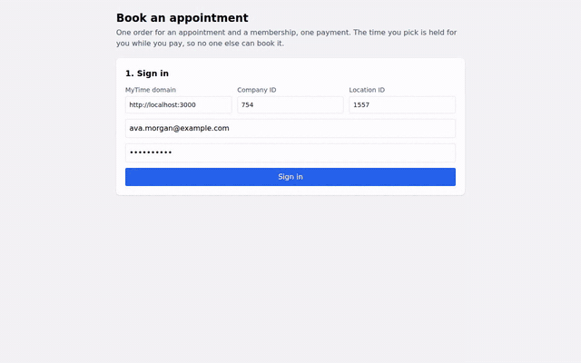

# MyTime Appointment + Membership Order (the time is held while the client pays)

This example books an appointment and sells a membership in one order through the **Marketplace Orders API**. The
time the client picks is **held** for them: it is taken out of everyone else's availability while they pay. Paying the
order in full books the appointment and starts the membership, on one ticket.

## Demo



[Download Full Video](./book_appointment_order.webm)

## Overview

`index.html` walks through:

1. Sign in (consumer login) and load the location's services, staff, prices and memberships
2. Pick a service, a staff member (or anyone), a day and an open time
3. Add a membership to the same order (optional)
4. Create the order: the appointment line is **held**, not booked yet, and a countdown shows how long
5. Check what another client sees for the same day and staff: the held time is not offered
6. Pick a saved card or add a Stripe card, and pay the full balance once
7. See the single ticket: the appointment now has an appointment number, and the membership is active

Errors are shown inline: a time someone else holds or booked, an expired order and a declined card.

## How the hold works

| | |
|---|---|
| `hold_until` | Until then the time is busy for everyone else (booking widget, other orders, the AI receptionist). Set per business, 5 minutes in the demo. |
| `expires_at` | The order stays payable until then (20 minutes). Its `access_token` stops working at the same moment. |
| Paying after `hold_until` | If the time is still free it is held again and the payment goes through. If someone else took it, `POST /intake/transactions` answers `422 slot_unavailable` and **nothing is charged**. |
| Not paid by `expires_at` | The order is voided automatically and the time released. Nothing was booked. |
| `DELETE /orders/{id}` | Cancels an unpaid order and releases the time right away. |
| Paid | The ticket closes, the hold becomes a real appointment (`appointment_id` on the line), the membership starts. |

Appointment holds work only for businesses that have the Orders API turned on (MyTime enables it per company).
Without it, `POST /orders` returns 404, and `appointments` is refused for businesses whose orders do not hold
appointment times.

## Endpoints, in order

All paths are under `{base_url}/api/mkp/v1`. Calls 1 to 4 use the consumer's `authentication_token` in the
`Authorization` header. The payment calls (6 and 7) use the order's `access_token` as `Authorization: Bearer <token>`.

| # | Call | Purpose |
|---|---|---|
| 1 | `POST /sessions` | Sign in; returns `user.authentication_token` |
| 2 | `PUT /user/client` | The client record at this company (`client.id`) |
| 3 | `GET /companies/{id}/deals?location_ids=&variation_setting=true`, `GET /companies/{id}/employees?location_ids=`, `GET /companies/{id}/pricings?location_ids=`, `GET /companies/{id}/memberships?location_id=` | Services (variations), staff, prices per staff, memberships sold online |
| 4 | `GET /open_times?date=&location_id=&variation_ids=&employee_ids=&is_existing_customer=false` | Open times for one service and day (no sign-in needed; a held time is left out) |
| 5 | `POST /orders` | Create the order and hold the time |
| 6 | `GET /intake/payment_methods`, `POST /intake/payment_methods` | List saved cards, save a new one |
| 7 | `POST /intake/transactions` | Pay the full balance |
| 8 | `GET /orders/{id}` | Read the order back (at any point) |
| – | `DELETE /orders/{id}` | Cancel an unpaid order and release the time |

### Create the order

```http
POST /api/mkp/v1/orders
Authorization: <user authentication_token>
Content-Type: application/json

{
  "location_id": 1557,
  "client_id": 147285,
  "lines": [],
  "appointments": [
    { "variation_ids": [309622], "employee_id": 6903, "begin_at": "2026-11-07T18:00:00Z" }
  ],
  "memberships": [
    { "membership_template_id": 513 }
  ]
}
```

- `appointments`: one entry per appointment, at most 10. `variation_ids` are the services (several make one longer
  appointment), `begin_at` is a time from `GET /open_times`, `employee_id` is optional (omitted: anyone free).
  `child_id` books it for a family member.
- `lines` (class seats) and `memberships` can be on the same order.

`201`:

```json
{
  "order": {
    "id": 2982,
    "status": "open",
    "expires_at": "2026-11-05T10:33:53Z",
    "hold_until": "2026-11-05T10:18:53Z",
    "subtotal": 74.0,
    "tax": 0,
    "balance_due": 74.0,
    "items": [
      { "type": "appointment_hold", "name": "Haircut", "service_name": "Haircut", "employee_id": 6903,
        "employee_name": "Olivia Hart", "begin_at": "2026-11-07T18:00:00Z", "end_at": "2026-11-07T18:45:00Z",
        "hold_until": "2026-11-05T10:18:53Z", "status": "pending", "amount": 45.0 },
      { "type": "membership_purchase", "name": "Membership Purchase: Glow Club Monthly", "amount": 29.0 }
    ]
  },
  "access_token": "<redacted>",
  "invoice_url": "…"
}
```

### Save a card and pay

```http
POST /api/mkp/v1/intake/payment_methods
Authorization: Bearer <order access_token>
{ "token": "pm_…" }                       # a Stripe PaymentMethod id created in the browser

POST /api/mkp/v1/intake/transactions
Authorization: Bearer <order access_token>
{ "card_id": "<id from GET /intake/payment_methods>", "amount": 74.0 }
```

The amount must be the full `balance_due`. `201` returns the closed `ticket` and the `transaction`.

### After payment

`GET /orders/{id}` returns the appointment line as a booked service:

```json
{ "type": "slot_variation", "service_name": "Haircut", "employee_name": "Olivia Hart",
  "begin_at": "2026-11-07T18:00:00Z", "appointment_id": 300580, "status": "converted", "amount": 45.0 }
```

## Results (local test run)

From the run filmed in the video: Ava books a 45-minute Haircut with Olivia at 10:00 AM and adds the Glow Club
Monthly membership.

| | Amount |
|---|---|
| Haircut with Olivia | $45.00 |
| Glow Club Monthly (first month) | $29.00 |
| **Charged once, on one ticket** | **$74.00** |

While the order was open, `GET /open_times` for Olivia that day no longer listed 9:30, 10:00 or 10:30 AM (the
haircut takes 45 minutes). After payment the ticket is `closed`, the appointment exists with its own number, and the
membership is active. Before payment neither existed.

Error responses from the same stack:

| Situation | Response |
|---|---|
| Another client orders a time someone holds | `422 {"errors":{"appointments[0]":[{"type":"no_available_employees"}]}}` |
| Paying after the hold lapsed, and someone else booked the time | `422 {"errors":{"general":[{"type":"slot_unavailable"}]}}`, no charge |
| The same client cancels (`DELETE /orders/{id}`) | `204`; the time is offered again right away |
| Paying after `expires_at` | `401 {"errors":{"access_token":[{"type":"expired"}]}}` |
| Paying part of the balance | `422 {"errors":{"general":[{"type":"order_must_be_paid_in_full"}]}}` |

## Running the example

1. Serve the repository folder (the page calls the API with `axios`, so any static server works):
   `python3 -m http.server 8090`
2. Open `http://localhost:8090/book_appointment_order/index.html`.
3. On the sign-in step, enter the **MyTime domain** (`sandbox.mytime.com` to test, `www.mytime.com` for production;
   a full URL such as `http://localhost:3000` also works), the **company ID** and the **location ID**.
4. Sign in with a consumer account, pick a service, staff, day and time, optionally add a membership, hold the time,
   check what another client sees, add a card and pay.

The same values can be passed as URL parameters, which pre-fill the form: `base_url`, `company_id`, `location_id`,
`email`, `password`, and `days_ahead` (default 14).

Requirements on the business: the Orders API enabled with appointment holds (MyTime turns it on per company),
services bookable online, memberships sold online if you want to offer one, and "Enable widget token auth via
headers" so the order token can be sent as `Authorization: Bearer`.

## Security

- The consumer token and the order `access_token` stay in the browser and grant access only to this consumer's data and
  this order. Never put a partner API key in frontend code.
- Card numbers go straight to Stripe; MyTime receives only the PaymentMethod id.
