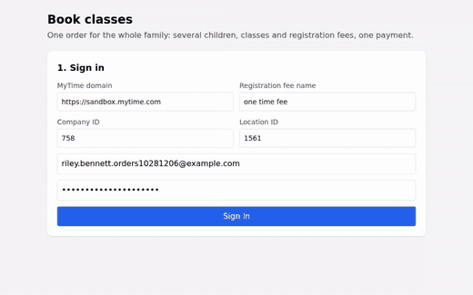

# MyTime Classes Order (one ticket for the whole family)

This example books classes for several children in one order, with each new child's registration fee included,
through the **Marketplace Orders API**. The parent gets one ticket, pays once, and the business's promotions
(sibling discounts, promo codes, membership benefits) are priced across the whole order.

## Demo



[Download Full Video](./book_classes_order.webm)

## Overview

`index.html` walks through:

1. Sign in (consumer login) and load the client's children, upcoming class sessions and the registration fee
2. Pick classes per child: single sessions, or a whole weekly series
3. Add the registration fee automatically for each new child (one who has not paid it yet) with their first booking
4. Create the order and show the lines the server priced, with discounts
5. Apply one or more promo codes
6. Pick a saved card or add a Stripe card, or pay with Afterpay when the business offers it (see *Afterpay (optional)*)
7. Pay once and see the single ticket with every class enrolled

Errors are shown inline: a full class, a members-only class without the fee, an expired order and a declined card.

## Why an order, and not one enrollment per child

The per-child flow (`POST /classes/enrollments`, then `POST /membership_purchases`) makes one ticket and one card charge
per child and per fee. Two new campers end up as four charges, and promotions that depend on the whole basket misfire:
a sibling discount never sees the second child, and a "$20 off" code applies once per child instead of once per family.

The Orders API puts everything on one open ticket priced by the server, and books nothing until it is paid:

| | Per-child enrollment | Orders API |
|---|---|---|
| Tickets / charges | one per child and per fee | one |
| Sibling and multi-class promotions | not applied across children | applied across the ticket |
| Promo codes | once per enrollment | once per order (`/intake/promotions`) |
| When seats and memberships are created | at each call | only after the payment succeeds |
| Abandoned checkout | enrollments to clean up | the order is voided automatically |

The Orders API is enabled per company by MyTime. Without it, `POST /orders` returns 404.

## Endpoints, in order

All paths are under `{base_url}/api/mkp/v1`. Calls 1 to 4 use the consumer's `authentication_token` in the
`Authorization` header. The payment calls (5 to 8) use the order's `access_token` as `Authorization: Bearer <token>`.

| # | Call | Purpose |
|---|---|---|
| 1 | `POST /sessions` | Sign in; returns `user.authentication_token` |
| 2 | `PUT /user/client` | The client record at this company (`client.id`) |
| 3 | `GET /user/children?company_id=`, `GET /classes/sessions?company_id=&location_id=&start_date=&end_date=`, `GET /companies/{id}/memberships?location_id=`, `GET /user/client_memberships?company_id=` | Children, sessions with price and `members_only`, the fee template, and which children already paid the fee |
| 4 | `POST /orders` | Create the order (one open ticket) |
| 5 | `POST /intake/promotions` | Apply a promo code (call again for each extra code) |
| 6 | `GET /intake/payment_methods`, `POST /intake/payment_methods` | List saved cards, save a new one |
| 7 | `POST /intake/transactions` | Pay the full balance |
| 8 | `GET /orders/{id}` | Read the order back (at any point) |
| – | `DELETE /orders/{id}` | Cancel an unpaid order |

### Create the order

```http
POST /api/mkp/v1/orders
Authorization: <user authentication_token>
Content-Type: application/json

{
  "location_id": 1557,
  "client_id": 147285,
  "lines": [
    { "session_id": 87, "attendee_id": 733, "child_id": 94 },
    { "session_id": 88, "attendee_id": 733, "child_id": 94, "recurrence_session_ids": [89, 90, 91] },
    { "session_id": 87, "attendee_id": 733, "child_id": 95 }
  ],
  "memberships": [
    { "membership_template_id": 513, "child_id": 94 },
    { "membership_template_id": 513, "child_id": 95 }
  ]
}
```

- Each `lines` entry is one seat for one child. `recurrence_session_ids` adds the later sessions of the same class (a
  weekly series) for that child.
- `attendee_id` is the session's attendee type (`session_attendees[].attendee_id` in `GET /classes/sessions`).
- `memberships` are memberships or registration fees bought on the same order. A members-only class
  (`session_attendees[].settings.members_only`) accepts a child whose membership is on the same order.

`201 Created` (abridged):

```json
{
  "order": {
    "id": 2982,
    "status": "open",
    "expires_at": "2026-10-28T05:59:05Z",
    "subtotal": 530.0,
    "discount": 19.0,
    "tax": 0,
    "balance_due": 511.0,
    "items": [
      { "type": "class_reservation", "id": 6957, "name": "Hiking Camp – Week 1 - Mia", "amount": 150.0,
        "amount_before_discount": 150.0, "session_id": 87, "child_id": 94, "child_name": "Mia",
        "class_name": "Hiking Camp – Week 1", "session_begin_at": "2026-11-02T17:00:00Z", "status": "pending" },
      { "type": "class_reservation", "id": 6962, "name": "Hiking Camp – Week 1 - Leo", "amount": 135.0,
        "amount_before_discount": 150.0, "child_id": 95, "status": "pending" },
      { "type": "membership_purchase", "id": 6963, "name": "Membership Purchase: Registration Fee", "amount": 35.0,
        "amount_before_discount": 35.0, "child_id": 94, "child_name": "Mia" }
    ]
  },
  "access_token": "<order access token>",
  "invoice_url": "https://…?access_token=…",
  "errors": {}
}
```

The order id is the ticket id. Keep the `access_token`: it pays the order.

Errors come back with `422` and are keyed by the line that failed, so you can show them next to that line:

```json
{ "errors": { "lines[0]": [{ "type": "session_full" }], "lines[1]": [{ "type": "members_only" }] } }
```

Codes: `session_full`, `members_only`, `already_enrolled`, `duplicate_seat`, `session_registration_closed`,
`session_unavailable`, `child_not_on_account`, `membership_not_available`, `appointments_not_supported`, and
`client_id: invalid_value`. Nothing is created when any line fails.

### Apply a promo code

```http
POST /api/mkp/v1/intake/promotions
Authorization: Bearer <order access_token>

{ "promotion_code": "SUMMER20" }
```

`201` returns `{ "ticket": { "id": 2982, "balance_due": 491.0, "status": "open" }, "promotion": { … } }`. Read the
order again to show the new line amounts. A refused code returns `422` with
`{ "errors": { "general": [{ "type": { "code": "criteria_failure", "name": "SUMMER20" } }] } }`.

### Save a card and pay

Create a Stripe PaymentMethod in the browser with Stripe Elements (`Stripe(company.stripe_key)`, the key from
`GET /companies/{id}`), then save it on the client's wallet:

```http
POST /api/mkp/v1/intake/payment_methods
Authorization: Bearer <order access_token>

{ "token": "pm_…" }
```

`GET /intake/payment_methods` lists the saved cards (`cards[].id`, `last4`). Pay the full balance:

```http
POST /api/mkp/v1/intake/transactions
Authorization: Bearer <order access_token>

{ "card_id": "<cards[].id>", "amount": 491.0 }
```

`201` returns `{ "ticket": { "id": 2982, "balance_due": 0.0, "status": "closed" }, "transaction": { … } }`. The class
enrollments and the client memberships are created now, when the ticket closes. `GET /orders/2982` then shows
`status: "closed"`, and the class lines become ordinary `session_enrollment` items on the same ticket. Those items
carry the class name and amount but no child or session time, so the example builds its receipt from the lines it
showed before payment.

Payment errors (`422`, nothing is charged):

| `errors.general[].type` | Meaning |
|---|---|
| `session_full`, `members_only` | Seats and membership rules are checked again before the card is charged |
| `order_expired` | The order passed `expires_at`; start a new order |
| `order_must_be_paid_in_full` | Orders cannot be part-paid; send `amount` = `balance_due` |
| `transaction_failed` | The card was declined; the message is in `general` |
| `ticket_void` | The order was cancelled or expired |
| `order_already_charged` | A payment is already on the order; do not charge again |
| `order_close_failed_refunded` | The card was charged but the booking could not complete, so the payment was refunded automatically and the order stays open |
| `order_close_failed_refund_failed` | As above, but the automatic refund failed; the business is alerted |

After `expires_at`, every call made with the order's `access_token` returns
`401 {"errors":{"access_token":[{"type":"expired"}]}}`. Treat that, `order_expired` and `ticket_void` as "this order
expired": nothing was charged, so offer to start a new order.

Known issue: today the 401 (and the 422 refusals of `/intake/promotions`) reach browsers without CORS headers, so
`axios` reports a network error with no response. The example handles it by re-reading the order with the user token
(`GET /orders/{id}`). If the order is no longer open, or `expires_at` has passed, the page treats it as expired.

## Afterpay (optional)

The pay step can also offer **Pay with Afterpay** (four interest-free payments). It is an add-on: the card flow above
is unchanged, and the page shows Afterpay only when the payment session says it is offered.

**Requirements**

- Afterpay turned on for the business by MyTime, on a Stripe account that can take Afterpay. `GET /companies/{id}`
  then returns `enable_afterpay: true` and `afterpay_capability_active: true`.
- A balance between **$1 and $4,000 USD** (`afterpay_min_amount` / `afterpay_max_amount` on the same response).
- Billing name, email and address. The example sends the billing address as the shipping address too.
- An order with a membership line (a registration fee is one) needs a **saved card on the client**, unless the business has
  switched off *Require credit card for membership purchase* (POS settings). Otherwise `POST /intake/transactions` refuses
  with `saved_payment_method_required`, after Afterpay has already approved. The example asks for the card first. Pass
  `memberships_need_card=0` in the URL when the business has switched that setting off.

**Calls, in order** (all with `Authorization: Bearer <order access_token>`)

1. `GET /user/payment_methods/session?company_id=&location_id=&amount=<balance_due>&payment_type=card&add_to_client=false&guest=false&wallet=false&callback_url=<this page>`.
   This is the same call MyTime's invoice page makes. It returns `{ "client_secret": "pi_…_secret_…", "afterpay_available": true }`.
   Show Afterpay only when `afterpay_available` is `true`. Call it again whenever the balance changes, for example after a
   promo code.
2. In the browser, use `Stripe(company.stripe_key).confirmAfterpayClearpayPayment(client_secret, { payment_method: { billing_details: { name, email, address } }, shipping: { name, address }, return_url })`.
   Stripe sends the parent to Afterpay to approve. In test mode this is Stripe's page with *Authorize* and *Fail* test payment
   buttons.
3. Afterpay sends the parent back to `return_url` with `payment_intent`, `payment_intent_client_secret` and
   `redirect_status`. Read the payment with `stripe.retrievePaymentIntent(client_secret)`:
   - `requires_capture` (approved and held) or `succeeded`: record it on the order.
   - Anything else (declined or cancelled): nothing was charged, and the order is still open. Offer the card, or Afterpay
     again.
4. Record the payment on the order with `POST /intake/transactions`:

   ```json
   { "payment_intent": { "id": "pi_…", "amount": 15000, "status": "requires_capture",
                         "payment_method": { "id": "pm_…", "type": "afterpay_clearpay" } },
     "payment_method_type": "afterpay_clearpay" }
   ```

   MyTime captures the held amount and closes the order, the same way the card flow does: `201` with
   `ticket.status: "closed"`. The ticket's payment is an Afterpay (`afterpay_clearpay`) transaction. The payment errors in
   the table above apply here too.

The page leaves for Afterpay, so whatever it needs to finish (the order id, the order and user tokens, and the lines
priced) has to survive the round trip. The example keeps them in `sessionStorage` and removes them on return.

**Caveats**

- **The order can expire while the parent is at Afterpay.** Seats are held for 20 minutes from the order's creation, and
  the approval does not extend that. If the parent comes back after `expires_at`, `POST /intake/transactions` returns
  `401 access_token expired`, and the order is voided. Afterpay's approval is then left as an authorization that MyTime
  never captures, until Stripe cancels it when it lapses. Start Afterpay with enough time left on the countdown.
- **Nothing finishes the payment if the browser never comes back.** MyTime completes an approved Afterpay payment on its
  own only for gift cards and packages bought on MyTime's pages, not for orders. If the parent closes the tab after
  approving, the order stays open until it expires, and the Afterpay authorization is never captured, as above.
- The same applies to any refusal at step 4 (a seat taken meanwhile, `saved_payment_method_required`): Afterpay has
  approved, but MyTime captures nothing and books nothing. Check what you can before step 2.
- Every session call creates a new Stripe PaymentIntent. Unused ones are never charged.

## Expiry

An order holds its seats for 20 minutes (`order.expires_at`), and its `access_token` stops working at the same moment
(`401 access_token expired`). A background sweep then voids the order: the ticket becomes `void` with `balance_due: 0`,
and the class lines become `expired`. Nothing was booked, so there is nothing to clean up. Show a countdown, and offer
"start a new order" when it runs out. `DELETE /orders/{id}` cancels an unpaid order right away
(`204`; `422` once it is paid).

## Results (local test run)

These numbers come from the run filmed in the video above. Mia books Hiking Camp ($150) and the 4-week Nature
Explorers series (4 × $40). Leo books Hiking Camp ($150). Both are new campers, so each gets a $35 Registration Fee.

| | Amount |
|---|---|
| Subtotal | $530.00 |
| Sibling discount (automatic: 10% off one class per 2 classes) | -$19.00 ($15 on Leo's camp, $4 on one Nature Explorers session) |
| SUMMER20 (code, $20 off the ticket) | -$20.00 (shown on Mia's fee line) |
| **Charged once, on one ticket** | **$491.00** |

After payment the ticket is `closed` and holds 6 class enrollments and 2 active Registration Fee memberships. Before
payment none of them existed.

Key error responses from the same stack:

| Situation | Response |
|---|---|
| Two children for the last seat | `422 {"errors":{"lines[0]":[{"type":"session_full"}],"lines[1]":[{"type":"session_full"}]}}` |
| A second order paid after the last seat was taken | `422 {"errors":{"general":[{"type":"session_full"}]}}`, no charge |
| A members-only class without the fee | `422 {"errors":{"lines[0]":[{"type":"members_only"}]}}` |
| Paying after `expires_at` | `401 {"errors":{"access_token":[{"type":"expired"}]}}` |
| Paying part of the balance | `422 {"errors":{"general":[{"type":"order_must_be_paid_in_full"}]}}` |
| A declined card | `422 {"errors":{"general":[{"type":"transaction_failed","general":["This card was declined, …"]}]}}`, order stays open |
| `PUT /tickets/{id}/close` on an order | `422 {"errors":{"general":[{"type":"order_not_supported","message":"Pay this order through /intake/transactions."}]}}` |
| Orders switched off for the company / globally | `404 not_found` / `503 orders_api_disabled` |

## Running the example

1. Serve the repository folder (the page calls the API with `axios`, so any static server works):
   `python3 -m http.server 8090`
2. Open `http://localhost:8090/book_classes_order/index.html`.
3. On the sign-in step, enter the **MyTime domain** (`sandbox.mytime.com` to test, `www.mytime.com` for production;
   a full URL such as `http://localhost:3000` also works), the **company ID** and **location ID** that sell the classes,
   and the name of the **registration fee** membership.
4. Sign in with a consumer account that has children at that company, pick classes, create the order, apply a code,
   add a card and pay.

The same values can be passed as URL parameters, which pre-fill the form: `base_url`, `company_id`, `location_id`,
`email`, `password`, `fee_name` (the name of the registration fee membership, default `Registration Fee`),
`days_ahead` (default 45), and `memberships_need_card` (Afterpay only, see above).

Requirements on the business: the Orders API enabled (MyTime turns it on per company), classes sold online, the
registration fee as a membership template sold online, and "Enable widget token auth via headers" so the order token
can be sent as `Authorization: Bearer`. Promo codes must be enabled for online booking and must not be auto-apply.
In our test data, SUMMER20's criterion is "1 class or membership". A "1 class" criterion was refused on orders that
also hold a fee line.

## Automated test (Playwright)

`e2e/happy_path.mjs` runs the full happy path headless: Mia books Hiking Camp and the 4-week Nature Explorers series,
Leo books Hiking Camp, both registration fees are added, SUMMER20 is applied, a Stripe test card is saved and the
order is paid. It then checks through the API that the ticket is closed, every class line is enrolled and both
registration fees are active.

```bash
npm i -D playwright && npx playwright install chromium   # or point PLAYWRIGHT_PATH at an existing install
python3 -m http.server 8090 &
PAGE_URL=http://localhost:8090/book_classes_order/index.html BASE_URL=http://localhost:3000 \
  COMPANY_ID=754 LOCATION_ID=1557 DEMO_EMAIL=dana.rivers@example.com DEMO_PASSWORD=… \
  node book_classes_order/e2e/happy_path.mjs
```

`RECORD_DIR=<dir>` records a video and `SLOW_MO=<ms>` slows every step down.

`e2e/afterpay_path.mjs` pays an order with Afterpay on Stripe's test page (`AFTERPAY_OUTCOME=authorize`), or declines
there (`AFTERPAY_OUTCOME=fail`) and checks that the order is still open with nothing charged. It needs a business with
Afterpay on. The header of the file lists its settings (`CHILD`, `PICKS`, `SAVE_CARD`, `MEMBERSHIPS_NEED_CARD`). The test expects two children who have not
paid the registration fee yet, so run it against freshly seeded test data.

## Security

- The consumer token and the order `access_token` stay in the browser and grant access only to this consumer's data and
  this order. Never put a partner API key in frontend code.
- Card numbers go straight to Stripe; MyTime receives only the PaymentMethod id.
